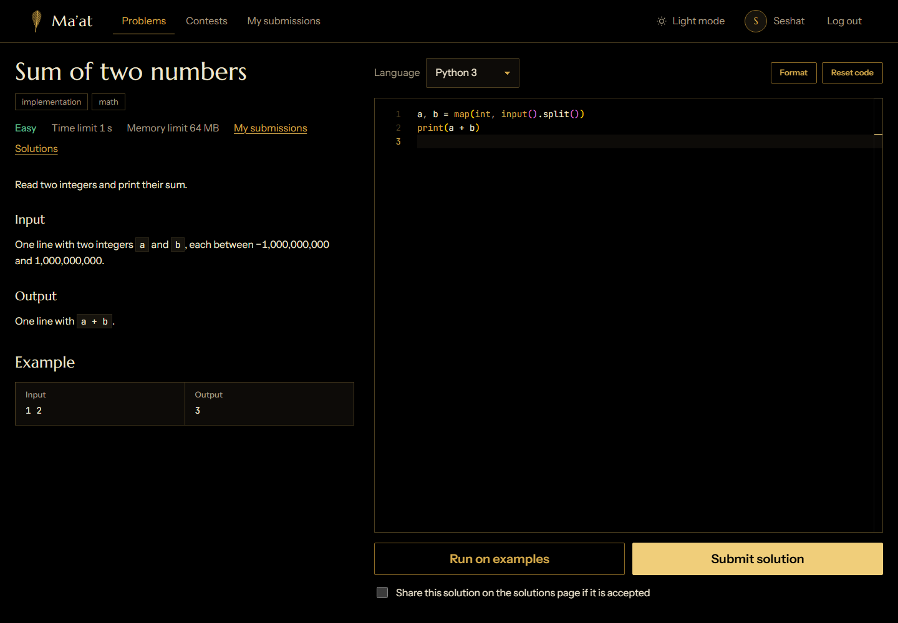
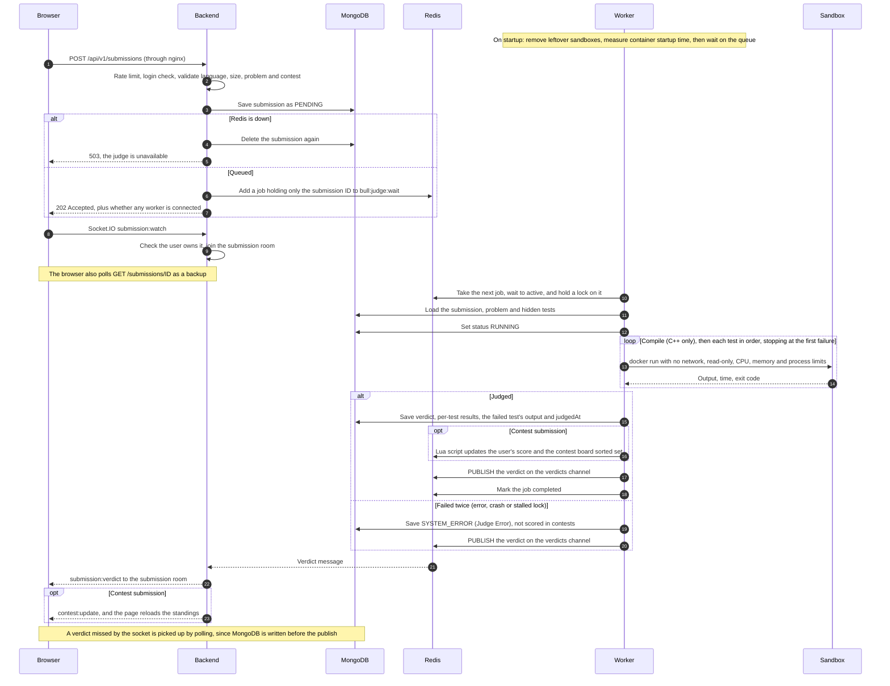

# Ma'at

Ma'at is a distributed online judge for people practicing competitive programming and for anyone running a small contest. You write a solution in C++ or Python, submit it, and a few seconds later you see whether it was right. It is named after the Egyptian goddess of truth and justice.

The hard part of a judge is running code written by strangers without trusting it. Every compile and every test here runs in its own throwaway Docker container with no network, a read-only filesystem and strict limits on CPU, memory, processes and file size.

**Status:** work in progress, not live yet. It will be served at `maat.project-graphite.com`.



## What it does

- Browse problems, search them by title and filter them by difficulty or topic
- Read the statement and write a solution in an in-browser editor with VS Code-style snippets and suggestions
- Submit C++17 or Python 3 code and get the verdict live, with the time of each test, without refreshing
- Open each test your submission ran, up to the one it failed, to see the full input, the expected output, and what your code printed there
- Get one of seven verdicts: Accepted, Wrong Answer, Time Limit Exceeded, Memory Limit Exceeded, Runtime Error, Compile Error, or Judge Error if the judge itself fails
- Join timed contests with ICPC-style scoring and a leaderboard that updates as submissions are judged
- See which problems you have solved or tried, in every problem list
- Upload a profile picture, which is re-encoded before it is stored
- Delete your account. It is kept for 30 days in case you change your mind, then removed with all its data
- Run code on a problem's examples before submitting, and format it with one click, wrapped to the width of the editor
- Share accepted solutions, and read other people's once a problem is no longer in a running contest
- See each problem's topics, such as greedy or graphs, once no contest that uses it is still to come or running
- Follow your progress on your profile: problems solved by difficulty and your latest submissions
- Switch between dark and light mode
- Manage problems, hidden test cases, contests and users from an admin area. A super admin also manages the admins

## How it works

```
                 ┌──────────┐   HTTP / WebSocket   ┌───────────┐
                 │ Frontend │ ◄──────────────────► │  Backend  │
                 └──────────┘                      │ (Express) │
                                                   └─────┬─────┘
                                      saves submission   │   enqueues job
                                  ┌──────────────────────┼──────────────┐
                                  ▼                      ▼              ▼
                            ┌──────────┐           ┌──────────┐   ┌──────────┐
                            │ MongoDB  │           │  Redis   │   │  MinIO   │
                            └────▲─────┘           │ queue +  │   │ profile  │
                                 │                 │ pub/sub  │   │ pictures │
                                 │ verdicts        └────┬─────┘   └──────────┘
                            ┌────┴─────┐  pulls jobs    │
                            │ Workers  │ ◄──────────────┘
                            └────┬─────┘
                                 │ docker run, one per test
                                 ▼
                          ┌─────────────┐
                          │   Sandbox   │
                          └─────────────┘
```

1. The backend validates the submission, saves it as `PENDING` and puts a job on a BullMQ queue. It answers right away with `202 Accepted`.
2. A worker takes the job, compiles the code if needed, then runs it against each test case in a fresh sandbox container.
3. The worker compares the output with the expected answer, saves the verdict to MongoDB and publishes it on a Redis channel.
4. The backend receives that message and pushes it to the browser over Socket.IO. If the socket drops, the frontend falls back to polling.

If no worker is running, submissions wait in the queue. `/health` reports how many workers are connected, and the problem page tells the user the judge is offline.

Because workers are stateless and only talk to the queue, more capacity is just more workers. Judging is CPU-bound, so throughput climbs with each worker until the host runs out of cores. [load-tests](load-tests) shows where that happens.

### One submission in detail



## Tech stack

| Part | Choice |
| :--- | :--- |
| Frontend | React, Vite, plain CSS, Monaco editor |
| API | Node.js, Express, Mongoose |
| Database | MongoDB |
| Queue and leaderboard | Redis, BullMQ, sorted sets |
| Live updates | Socket.IO |
| File storage | MinIO (S3 compatible) |
| Sandbox | Docker |
| Testing and linting | Vitest, Supertest, Playwright, k6, Prettier, oxlint |
| CI | Project Graphite's shared GitHub Actions workflows |
| Deployment | Docker Compose through Project Graphite's platform, Traefik, images on GHCR |

## Repository layout

| Folder | What it is |
| :--- | :--- |
| [frontend](frontend) | The React app |
| [backend](backend) | The REST API and the Socket.IO server |
| [worker](worker) | The judge: pulls jobs and runs code in sandboxes |
| [load-tests](load-tests) | k6 scripts and the recorded benchmarks |
| [infra](infra) | MinIO setup, and backup and restore scripts for the Compose stack |
| [compose.yaml](compose.yaml) | The whole stack, for running locally |
| [deploy](deploy) | The draft of `platform/deploy/maat/`, and how to ship it |
| [.env.example](.env.example) | The only settings file, for every service. Copy it to `.env` |

## Running it locally

You need Docker Engine 28 or newer, with Compose. Node.js 24 is only needed to run the tests or to work on one part outside Docker.

1. Copy `.env.example` to `.env` and fill in the five empty passwords and secrets at the top (`openssl rand -hex 32` makes a good one). Use hex, because some of them go inside URLs.
2. Build the two sandbox images: `docker compose --profile build build sandbox-cpp sandbox-python`
3. Start everything: `docker compose up -d --build --wait`
4. Add the example problems, a practice contest and the super admin account:
   `docker compose exec -e SEED_ADMIN_EMAIL=you@example.com -e SEED_ADMIN_PASSWORD=a-long-password backend node scripts/seed.js`
5. Open http://localhost:8080.

On Linux, also set `DOCKER_GID` in `.env` to the output of `stat -c %g /var/run/docker.sock`. The worker does not run as root and needs that group to reach Docker. Docker Desktop works without it.

### One settings file

The root `.env` is the only one. Compose reads it, and so do the backend, worker and frontend when you run them with npm, so there are no `.env` files in their folders. The database, Redis and MinIO addresses are not in it: Compose sets them inside Docker, and outside Docker each service builds them for `127.0.0.1` from the passwords.

### Settings

| Variable | Meaning |
| :--- | :--- |
| `MONGO_PASSWORD`, `REDIS_PASSWORD` | Database and queue passwords, in hex. `MONGO_PASSWORD` only takes effect on an empty database, so to change it later change it inside MongoDB first |
| `JWT_SECRET` | Signs sessions. Changing it logs everyone out |
| `MINIO_ROOT_USER`, `MINIO_ROOT_PASSWORD` | MinIO's admin, used only to set up the bucket |
| `S3_BUCKET`, `S3_ACCESS_KEY`, `S3_SECRET_KEY` | The bucket and the restricted account the API uses |
| `NODE_ENV` | `development` here. `production` hides error details and marks the cookie Secure |
| `FRONTEND_URL` | The site's address, and the only origin allowed to make changes |
| `VITE_SITE_URL`, `VITE_CONTACT_EMAIL` | Built into the frontend when it is built here |
| `IMAGE_TAG` | Tag of the app images. `local` for images built here |
| `DOCKER_GID` | Group of the Docker socket |
| `JWT_EXPIRES_IN`, `JWT_COOKIE_EXPIRES_IN` | Token lifetime, and cookie lifetime in days |
| `API_RATE_LIMIT` | Requests per IP per hour |
| `EMAIL_HOST`, `EMAIL_PORT`, `EMAIL_USERNAME`, `EMAIL_PASSWORD`, `EMAIL_FROM` | SMTP. With `EMAIL_HOST` empty in development, emails are printed to the backend's log |
| `WORKER_CONCURRENCY`, `SANDBOX_CPUSET` | Submissions judged at once, and the cores sandboxes may use |

### Backup and restore

For the Compose stack in this repository:

```sh
BACKUP_DIR=./backups bash infra/backup/backup.sh
bash infra/backup/restore.sh backups/<stamp> --yes
```

A backup holds MongoDB, Redis and MinIO, is checked as it is written, and is deleted after 14 days by a later run. Redis and MinIO pause for about a second while they are copied. A restore replaces all current data.

### Resource limits

Every service in `compose.yaml` has a CPU and memory cap that together model a small server of about 4 vCPU and 3 GB, and every long-running one also reserves memory. Due to limited resources, the load tests were run locally against this capped setup rather than on dedicated cloud machines, so the numbers in [load-tests](load-tests) describe that small server. Sandboxes are started by the worker outside Compose and carry their own limits: one CPU each and the problem's memory limit, or 512 MB to compile.

Each folder has its own README with the details.

## Deploying

Ma'at is deployed on the shared Project Graphite VPS through [platform](https://github.com/Project-Graphite/platform), like the organisation's other projects. The platform's Traefik provides HTTPS and the platform creates the DNS record. Its production Compose file and values belong in `platform/deploy/maat/`: a draft of them, with the exact steps, is in [deploy](deploy). The `compose.yaml` here is for running locally.

### Before the first deploy

**Ma'at cannot be deployed until all of these are done.**

Needed from an organisation owner:

- [ ] An agreed exception to the handbook's [rule on untrusted workloads](https://github.com/Project-Graphite/docs/blob/main/recommendations.md)
- [ ] A rootless Docker daemon for the judge, under its own user with CPU and memory limits, so that the worker never gets the host's main Docker socket
- [ ] An exception in the platform's deploy agent for that daemon's socket and the jobs folder, on Ma'at's worker only. The agent refuses host paths otherwise. Install it by copying `agent.py` and restarting `graphite-agent`: running `bootstrap.sh` again would overwrite `/etc/graphite/agent.env`
- [x] The GHCR packages `maat/backend`, `maat/worker` and `maat/frontend` made public
- [ ] The secrets below entered in the console, and "operate" access to Ma'at for whoever seeds it

Needed from the project:

- [x] `deploy/maat/` drafted in [deploy](deploy)
- [ ] That folder in a pull request to `platform`, with a real image tag
- [x] Verified MongoDB and Redis dumps in volumes labelled for backup, since copying the files of a running database is not safe
- [x] The two sandbox images built on the judge's daemon by the worker when it starts
- [x] HSTS and compression in nginx, which the platform's Traefik does not add
- [ ] A test of every verdict on the rootless daemon, memory limits and CPU pinning included
- [x] `deploy` in [.graphite.yml](.graphite.yml) set to `kind: compose` and `host: maat.project-graphite.com`

### Secrets

Entered in the console under `/maat/`, never committed:

| Name | Value |
| :--- | :--- |
| `MONGO_PASSWORD`, `REDIS_PASSWORD` | Random hex, from `openssl rand -hex 32`. They go inside URLs |
| `JWT_SECRET` | Random hex |
| `MINIO_ROOT_PASSWORD`, `S3_SECRET_KEY` | Random hex |
| `EMAIL_HOST`, `EMAIL_USERNAME`, `EMAIL_PASSWORD`, `EMAIL_FROM` | SMTP, required for password reset emails |

The platform's file has to set `NODE_ENV=production` and `FRONTEND_URL=https://maat.project-graphite.com`. With a wrong `FRONTEND_URL`, logins and submissions answer 403.

### The first admin

After the first deploy, open the backend container's terminal in the console and run:

```sh
read -rp "Admin email: " SEED_ADMIN_EMAIL
read -rsp "Admin password: " SEED_ADMIN_PASSWORD
export SEED_ADMIN_EMAIL SEED_ADMIN_PASSWORD
node scripts/seed.js
unset SEED_ADMIN_EMAIL SEED_ADMIN_PASSWORD
```

The site is public by then, so the seed never promotes an existing account. If someone registered that email first, it stops without changing anything: use another email. Run it once, because running it again resets the example problems.

### Updates and rollbacks

Once `platform/deploy/maat/` exists, a push to `main` whose checks and images pass records its `sha-` tag there, and the platform deploys it. Every successful run of the Main workflow builds all three images, so one tag always covers the whole stack.

To roll back, set `IMAGE_TAG` in `platform/deploy/maat/values` to an older tag whose run built its images. When pushes come quickly GitHub skips the waiting runs in between, so not every commit has images. A rollback does not undo database changes.

### When something is wrong

| Symptom | Look at |
| :--- | :--- |
| The deploy says "may not use" | The agent refused a host path or setting. Its exception is missing or not installed |
| The deploy says "waiting on secrets" | The console's Secrets page names the missing ones |
| Images fail to pull | The commit's image jobs failed, or the GHCR packages are still private |
| The worker keeps restarting | Its logs in the console. `Could not start` means a sandbox image is missing or `SANDBOX_CPUSET` names a core that does not exist. `permission denied` means it cannot reach the judge's socket |
| Submissions end as Judge Error | The worker's logs |
| Anything else | The organisation's [troubleshooting guide](https://github.com/Project-Graphite/docs/blob/main/troubleshooting.md) |

## Tests

| Where | Command | What it covers |
| :--- | :--- | :--- |
| `backend`, `worker`, `frontend` | `npm run lint` | Formatting in the backend and worker, lint rules in the frontend |
| `backend` | `npm test` | The API, against an in-memory MongoDB |
| `worker` | `npm test` | Verdict rules and contest scoring (scoring needs Redis) |
| `worker` | `npm run ad` | Hostile programs against the real sandbox (needs Docker and the sandbox images) |
| `frontend` | `npm test` | Components and helpers |
| `frontend` | `npm run test:e2e` | The main user flows in a real browser, against the running stack |

CI runs lint, `npm test` and the build for every service, builds the images, and scans the history for secrets. It does not run the adversarial and browser suites, so run those before a release.

## Contributing

This repository follows the [Project Graphite conventions](https://github.com/Project-Graphite/docs/blob/main/reference/conventions.md). Branches are named `type/short-summary`, and pull request titles follow `type(scope): summary`. Titles become the commit on `main` and decide the next version, which the Main workflow releases once checks and images have passed. The Changelog workflow does the same by hand, without waiting for them.

## Security

Running other people's code is the main risk, so the design assumes every submission is hostile.

- Sandboxes run with no network, a read-only root filesystem, all Linux capabilities dropped, no privilege escalation, and limits on memory, CPU, process count, file size and captured output. Docker keeps no log of what they print
- Commands are started with argument arrays rather than shell strings, so nothing in a submission can inject a command
- The backend, worker and frontend run without root, and each container gets only the settings it uses
- Access to a Docker socket is as powerful as the user running that daemon, root by default, and containers share the host's kernel. This is why the shared VPS needs a separate rootless daemon for the judge
- The seed never turns an existing account into the super admin, so registering the admin's email first gains nothing
- Hidden test data is shown only to admins and to the author of a submission, for the tests that submission ran, and never to the author while a contest with the problem is still to come or running
- Users read only their own submissions, apart from solutions their authors chose to share. Sockets join only the rooms of submissions their user may read
- Uploaded images are decoded and rebuilt from raw pixels, so metadata and hidden payloads do not survive
- Requests are stripped of NoSQL operators, text fields are filtered for XSS, and changes are accepted only from the site's own origin
- Every IP has an hourly request budget, and logins, password checks, signups, reset emails, submissions and uploads have tighter limits of their own
- Password reset tokens are redacted from the backend and nginx access logs
- nginx serves the site with a strict Content Security Policy the usual security headers and HSTS. In production Traefik adds HTTPS

Report a vulnerability privately, as the [security policy](https://github.com/Project-Graphite/.github/blob/main/SECURITY.md) describes.

## License

Released under the terms of the [LICENSE](LICENSE) file.
