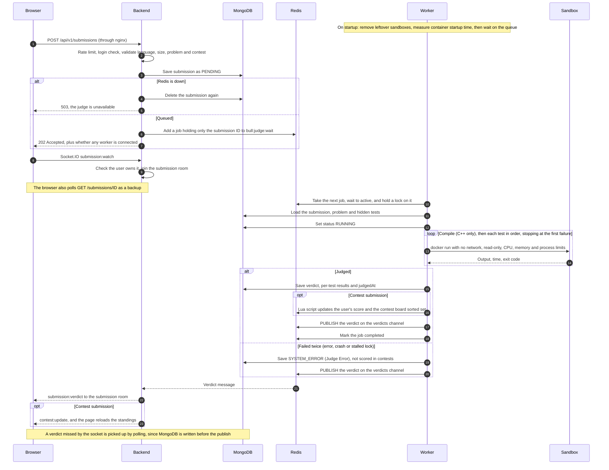

# Ma'at

Ma'at is a distributed online judge. You write a solution in C++ or Python, submit it, and a few seconds later you see whether it was right. It is named after the Egyptian goddess of truth and justice.

The hard part of a judge is running code written by strangers without trusting it. Every submission here runs in its own throwaway Docker container with no network, a read-only filesystem and strict limits on CPU, memory and processes. The container is destroyed as soon as the run ends.

## What it does

- Browse problems, read the statement and write a solution in an in-browser editor
- Submit C++17 or Python 3 code and watch the verdict arrive live, test by test, without refreshing
- Get one of seven verdicts: Accepted, Wrong Answer, Time Limit Exceeded, Memory Limit Exceeded, Runtime Error, Compile Error, or Judge Error if the judge itself fails
- Join timed contests with ICPC-style scoring and a leaderboard that updates as submissions are judged
- See which problems you have solved or tried, in every problem list
- Upload a profile picture, which is re-encoded before it is stored
- Delete your account. It is kept for 30 days in case you change your mind, then removed with all its data
- Manage problems and hidden test cases from an admin area

## How it works

```
                 ┌──────────┐   HTTP / WebSocket   ┌───────────┐
                 │ Frontend │ ◄──────────────────► │  Backend  │
                 └──────────┘                      │ (Express) │
                                                   └─────┬─────┘
                                      saves submission   │   enqueues job
                                  ┌──────────────────────┼──────────────┐
                                  ▼                      ▼              ▼
                            ┌──────────┐           ┌──────────┐   ┌──────────┐
                            │ MongoDB  │           │  Redis   │   │  MinIO   │
                            └────▲─────┘           │ queue +  │   │ profile  │
                                 │                 │ pub/sub  │   │ pictures │
                                 │ verdicts        └────┬─────┘   └──────────┘
                            ┌────┴─────┐  pulls jobs    │
                            │ Workers  │ ◄──────────────┘
                            └────┬─────┘
                                 │ docker run, one per test
                                 ▼
                          ┌─────────────┐
                          │   Sandbox   │
                          └─────────────┘
```

1. The backend validates the submission, saves it as `PENDING` and puts a job on a BullMQ queue. It answers right away with `202 Accepted`.
2. A worker takes the job, compiles the code if needed, then runs it against each test case in a fresh sandbox container.
3. The worker compares the output with the expected answer, saves the verdict to MongoDB and publishes it on a Redis channel.
4. The backend receives that message and pushes it to the browser over Socket.IO. If the socket drops, the frontend falls back to polling.

If no worker is running, submissions wait in the queue. `/health` reports how many workers are connected, and the problem page tells the user the judge is offline.

Because workers are stateless and only talk to the queue, more capacity is just more workers. Judging is CPU-bound, so throughput climbs with each worker until the host runs out of cores. [load-tests](load-tests) shows where that happens.

### One submission in detail



## Tech stack

| Part | Choice |
| :--- | :--- |
| Frontend | React, Vite, plain CSS, Monaco editor |
| API | Node.js, Express, Mongoose |
| Database | MongoDB |
| Queue and leaderboard | Redis, BullMQ, sorted sets |
| Live updates | Socket.IO |
| File storage | MinIO (S3 compatible) |
| Sandbox | Docker |
| Testing | Vitest, Supertest, Playwright, k6 |
| Deployment | Docker Compose |

## Repository layout

| Folder | What it is |
| :--- | :--- |
| [frontend](frontend) | The React app |
| [backend](backend) | The REST API and the Socket.IO server |
| [worker](worker) | The judge: pulls jobs and runs code in sandboxes |
| [load-tests](load-tests) | k6 scripts and the recorded benchmarks |
| [infra](infra) | Setup scripts for supporting services such as MinIO |

## Running it locally

You need Docker. Node.js 22 is only needed to run the tests or to work on one part outside Docker.

1. Copy `.env.example` to `.env` and fill in the values.
2. Build the two sandbox images: `docker compose --profile build build sandbox-cpp sandbox-python`
3. Start everything: `docker compose up -d --build`
4. Add the example problems and an admin account:
   `docker compose exec -e SEED_ADMIN_EMAIL=you@example.com -e SEED_ADMIN_PASSWORD=a-long-password backend node seed.js`
5. Open http://localhost:8080.

### Resource limits

Every service in `compose.yaml` has a CPU and memory cap that together model a small server of about 4 vCPU and 3 GB. Due to limited resources, the load tests were run locally against this capped setup rather than on dedicated cloud machines, so the numbers in [load-tests](load-tests) describe that small server. Sandboxes are started by the worker outside Compose and carry their own limits: one CPU each and the problem's memory limit.

Each folder has its own README with the details.

## Tests

| Where | Command | What it covers |
| :--- | :--- | :--- |
| `backend` | `npm test` | The API, against an in-memory MongoDB |
| `worker` | `npm test` | Verdict rules and contest scoring (scoring needs Redis) |
| `worker` | `npm run test:adversarial` | Hostile programs against the real sandbox (needs Docker) |
| `frontend` | `npm test` | Components and helpers |
| `frontend` | `npm run test:e2e` | The main user flows in a real browser, against the running stack |

## Security

Running other people's code is the main risk, so the design assumes every submission is hostile.

- Sandboxes run with no network, a read-only root filesystem, all Linux capabilities dropped, no privilege escalation, and limits on memory, CPU, process count and output size
- Commands are started with argument arrays rather than shell strings, so nothing in a submission can inject a command
- Hidden test data is never returned by any public route, only the sample cases
- Users can only read their own submissions, and sockets can only join the room of a submission they own
- Uploaded images are decoded and rebuilt from raw pixels, so metadata and hidden payloads do not survive
- Requests are sanitized against NoSQL and XSS injection and checked against the allowed frontend origin
- Every IP has an hourly request budget, and logins, password checks, signups, reset emails, submissions and uploads have tighter limits of their own
- The site is served with a strict Content Security Policy and the usual security headers

## License

Released under the terms of the [LICENSE](LICENSE) file.
